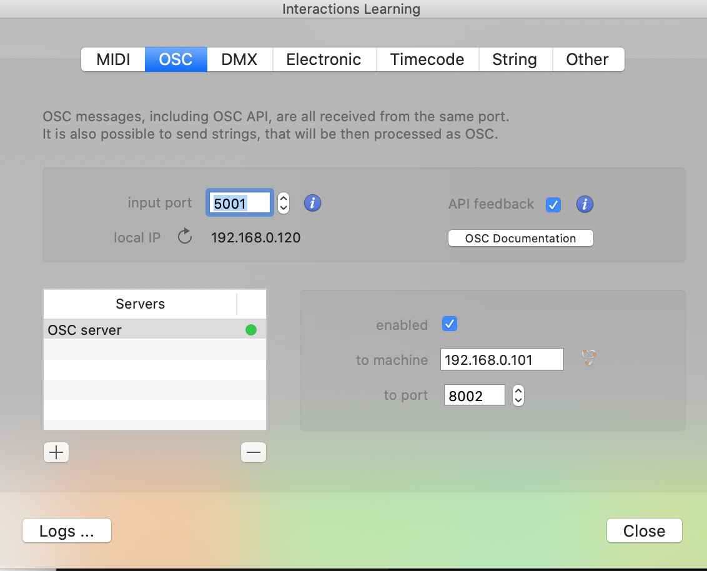
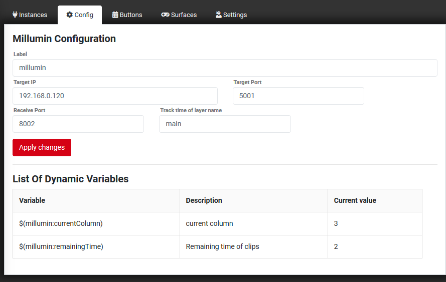

## Millumin (v5)

Controls Millumin over OSC and tracks its state through the OSC "API feedback".
Covers the whole [Millumin V5 OSC API](https://github.com/anome/millumin-dev-kit/wiki/OSC-documentation).
Also works with Millumin 4 for the commands that exist there.

### Setup

In Millumin, open the **Device Manager** (`CMD+K`), **OSC** tab:

- enable OSC input on the port set as **Sending port** in Companion (default `5000`)
- enable **API feedback** towards the Companion computer, on the port set as **Receive port** (default `8000`)

With **Send /ping on connection** enabled, Companion asks Millumin for the state of all the layers when it connects.

### Targets

Most layer / light / media actions have a **Target**:

| Target | OSC address |
| --- | --- |
| Selected layer / Selected light | `/selectedLayer/...`, `/selectedLight/...` |
| Layer by name | `/layer:Name/...` |
| Light by name | `/light:Name/...` |
| Element by index | `/index:N/...` |
| Element by name | `/Name/...` |
| Media by name (media actions) | `/Movie.mov/...` |

Names, indexes and values accept Companion variables.
**Mode** "Increase by / Decrease by" uses Millumin's relative suffixes `/+` and `/-`.

### Actions

- **Columns**: launch, launch or stop (by index or name), stop, previous, next
- **Transport**: play, pause, play/pause, go to time (seconds, negative = from the end, or timecode `01:02:03.456`), jog, go to timeline segment
- **Select**: board, layer, light (by index or name), select/deselect through the `selected` property
- **Masters**: video, audio, DMX
- **Layer**: opacity, position (XY, X, Y), rotation, scale, mapping corners, effect parameters, any property
- **Light**: intensity
- **Media**: start (restart / column index / media or column name), pause, start or pause, stop, go to time, jog, normalized time, speed, text, Quartz Composer inputs
- **Import**: import file or folder (optionally on a column, optionally start it), clear media
- **Display**: fullscreen, test card, workspace
- **Project**: open, save, save as, quit
- **Feedback**: `/ping`, request a property value (`/?`)
- **Custom OSC**: any address with typed arguments (`i:1, f:0.5, s:text`)

### Feedbacks

- Column is launched (index or name)
- Media status on a layer (playing / paused / stopped / loaded), optionally for a given media name or column
- Media remaining time below N seconds
- Media progress bar
- Layer / light is selected
- Property value comparison (opacity, position, rotation, scale, intensity, mapping, media time, speed, name…)
- Feedback received recently (connection watchdog)

### Variables

- Columns: `currentColumnIndex`, `currentColumnName`, `previousColumnName`, `nextColumnName`, `launchedColumns`, `lastStoppedColumnIndex`, `lastStoppedColumnName`
- Selection: `selectedLayer`, `selectedLight`, `selectedIndex`
- Tracked time layers (set in the configuration, `firstByIndex` = `index:1`): `media_<layer>_elapsedTime`, `_remainingTime`, `_duration` (seconds, `_HHMMSS`, `_MMSS`), `_progress`, `_progressPercent`, `_name`, `_index`, `_status`, `_speed`
- Selected layer / light and every element reported by Millumin (e.g. `layer_Video_...`, `light_Par1_...`, `index_2_...`): `_opacity`, `_x`, `_y`, `_rotation`, `_scale`, `_intensity`, `_selected`, `_media_elapsed`, `_media_remaining_MMSS`, `_media_name`, `_media_status`…
- `lastFeedbackAge`: seconds since the last message from Millumin

> Property values only appear once Millumin has sent them (on change, after `/ping`, or with the "Request property" action).

### Presets

Columns (with launched state), transport and jog, selected layer media (with playing/paused state, speed, timer with progress bar), selected layer properties, layer selection, lights, masters, display, project & connection watchdog, and timers for each tracked layer.

### Upgrading from 4.x

The former "Selected Layer / …" media actions are migrated automatically to the new media actions with target "Selected layer"; existing buttons keep working.
